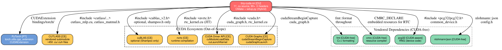

# MUSIFY — tiny-cuda-nn

| Field | Value |
|-------|-------|
| Project | tiny-cuda-nn |
| Source repo | https://github.com/NVlabs/tiny-cuda-nn |
| Migration branch | musa |
| Artifact type | Hybrid |
| Build system | CMake (LANGUAGES CXX CUDA) + setup.py (CUDAExtension) |
| Test infrastructure | CTest (tests/: test_encodings, test_grid, test_jit_losses, test_networks) |
| MUSA SDK version | 4.3.5 |
| torch_musa version | v2.7.1 |
| Docker image | 4.3.5_kuae2.1_20260119_torch2.7.1_ubuntu |
| MT GPU type | S5000 |
| Pipeline start | 2026-03-14 15:03:20 UTC |
| Pipeline end | 2026-03-14 15:41:04 UTC |
| Elapsed | 0h 37m 44s |
| Last updated | 2026-03-14 15:41 |
| Director | xiaofeng |
| Status | blocked |

## Migration Plan

Migrate tiny-cuda-nn (NVlabs' tiny CUDA neural network framework) from CUDA to MUSA. The project is a Hybrid type (CMake C++ library + PyTorch Python bindings via setup.py). It includes 18 primary .cu files + ~90 headers, with a vendored CUTLASS submodule (~450 files). The pipeline will: analyze CUDA code, resolve API mappings, port code via SimplePorting, adapt CMake + setup.py build systems, and verify on MT GPU hardware.

**Key challenges:**
1. PTX inline assembly: mma.sync and wmma tensor core instructions (mma.h)
2. NVRTC runtime compilation (rtc_kernel.cu) — needs MUSA equivalent
3. Hardcoded WARP_SIZE = 32 (common.h) — MUSA S5000 warp size is 128
4. CUDA Driver API for JIT kernel loading
5. CUDA Graph API usage (cuda_graph.h)
6. Vendored CUTLASS dependency for matrix operations

## CUDA Dependencies

None — all dependencies are either CUDA ecosystem (handled by API mapping) or CUDA-free.

| # | Dependency | Classification | Notes |
|---|-----------|---------------|-------|
| 1 | CUTLASS | CUDA-ecosystem (vendored submodule) | Template library for matrix ops, ~450 files |
| 2 | cuBLAS | CUDA-ecosystem (optional) | Only for Shampoo optimizer (TCNN_ALLOW_CUBLAS_CUSOLVER) |
| 3 | nvrtc | CUDA-ecosystem | Runtime compilation for JIT kernels |
| 4 | CUDA Driver API | CUDA-ecosystem | Module loading for JIT |
| 5 | CUDA Graphs | CUDA-ecosystem | Graph capture/launch |
| 6 | fmt | CUDA-free | C++ formatting library |
| 7 | cmrc | CUDA-free | CMake resource compiler |
| 8 | pcg32 | CUDA-aware | RNG, header-only |
| 9 | nlohmann/json | CUDA-free | JSON parsing |

## Pipeline Progress

### tiny-cuda-nn (Main)

| Stage | Status | Started | Completed | Notes |
|-------|--------|---------|-----------|-------|
| 0. sdk-version | done | 2026-03-14 15:03 | 2026-03-14 15:05 | Core manifest resolved |
| 1a. reader (code analysis) | done | 2026-03-14 15:05 | 2026-03-14 15:12 | 18 .cu + ~90 .h primary files |
| 1b. lookuper (document-site) | done | 2026-03-14 15:05 | 2026-03-14 15:12 | Pre-existing, extended versions resolved |
| 1c. lookuper (docker setup) | done | 2026-03-14 15:05 | 2026-03-14 15:12 | Container running, GPU verified |
| 2. api-mapping | done | 2026-03-14 15:12 | 2026-03-14 15:18 | Full mapping complete, nvrtc NOT AVAILABLE |
| 3. musa-adapt | blocked | 2026-03-14 15:18 | 2026-03-14 15:41 | Build OK (mcc), runtime blocked by PrivateUse1 device |

#### Stage Details

**Stage 0 — SDK Version Resolution (Core):**
- torch_musa version: v2.7.1
- MUSA SDK version: 4.3.5
- Docker image: 4.3.5_kuae2.1_20260119_torch2.7.1_ubuntu
- Pull URL: sh-harbor.mthreads.com/mcctest/musa-train:4.3.5_kuae2.1_20260119_torch2.7.1_ubuntu

**Stage 1 — Parallel Preparation:**

*1a. Reader (code analysis):*
- Full report: [CODE_ANALYSIS.md](CODE_ANALYSIS.md)
- Project type: Hybrid (CMake C++ lib + PyTorch extension)
- CUDA files: 18 .cu (primary), ~90 .h headers, ~450 .cu/.cuh (vendored cutlass)
- Minimum CUDA version: 10.2 (Explicit), 11.8+ for full JIT functionality
- Dependencies requiring musification: none
- High-risk: PTX inline asm (mma.sync, wmma), NVRTC, WARP_SIZE=32, CUDA Driver API, CUDA Graphs
- Medium-risk: Vendored CUTLASS, __CUDA_ARCH__ guards
- Low-risk: cuBLAS (optional), half precision, Python bindings

*1b. Lookuper (document-site + extended versions):*
- document-site path: /cephfs/jing.feng/codebases/auto_musify/document-site/
- Branch `pre`: ready
- Branch `master`: ready
- Component versions resolved:
  - Driver: 3.3.5
  - MUSA Toolkits: 4.3.5
  - muDNN: 3.1.5
  - MCCL: 2.1.5
  - Triton: 1.4.5

*1c. Lookuper (docker setup):*
- Container name: musify_container
- GPU visible: yes (3x MTT S5000)
- MUSA version: 4.3.5
- torch_musa version: 2.7.1+5ee0a64
- PyTorch version: 2.7.1

**Dep Selection:** Zero in-scope deps. Skipped. Proceeding autonomously.

**Stage 2 — API Mapping:**
- Full report: [API_MAPPING.md](API_MAPPING.md)
- Mapping coverage: ~40 CUDA APIs with verified MUSA equivalents (Layer 1 via general.json)
- Custom rules needed: 10 (Layer 2 — CUDAExtension, Python APIs, cutlass->mutlass, warp size)
- **CRITICAL: nvrtc NOT AVAILABLE** — no MUSA equivalent for runtime compilation. Must build with `TCNN_BUILD_WITH_RTC=OFF`.
- **CRITICAL: WARP_SIZE** — must change from 32 to 128 for S5000.
- **HIGH RISK: PTX inline assembly** — mma.sync and wmma instructions in mma.h have no MUSA equivalent. Must be guarded or replaced.
- Ecosystem counterpart found: CUTLASS -> mutlass (MooreThreads/mutlass)

## Issues

| # | Team | Stage | Severity | Summary | Status | Resolution |
|---|------|-------|----------|---------|--------|------------|
| 1 | Main | 2. api-mapping | degraded | nvrtc (runtime compilation) has no MUSA equivalent | open | Build with TCNN_BUILD_WITH_RTC=OFF, disabling JIT-fused MLPs |
| 2 | Main | 2. api-mapping | degraded | PTX mma.sync/wmma instructions not available in MUSA | open | Guard with __MUSA_ARCH__ or disable fully_fused_mlp |
| 3 | Main | 2. api-mapping | blocking | WARP_SIZE=32 hardcoded, S5000 needs 128 | open | Change constant and verify all warp-level operations |

**Stage 3 — Adaptation:**
- adapt-code: done -- SimplePorting converted 11 .mu source + 59 .h headers + 4 .mu tests
- adapt-build: partial -- setup.py modified for MUSAExtension, builds with mcc
- adapt-verify: blocked -- C++ API allocates tensors on CUDA backend, needs PrivateUse1 fix
- adapt-fix iterations: 5 (incremental fixing of mapping gaps, PTX assembly, compiler macros)

## Knowledge Base

### [Round 1] adapt-code + adapt-build -- 2026-03-14
- **Status**: partial
- **What**: Full pipeline from clone through code analysis, API mapping, SimplePorting, build system modification, and compilation
- **Result**: Compilation succeeds with mcc. Runtime fails due to C++ API using CUDA device backend internally.
- **Root cause**: tiny-cuda-nn's C++ core (`cpp_api.cu`, `gpu_memory.h`) calls `torch::empty` with `at::kCUDA` device type. In torch_musa, the device is `PrivateUse1`, not `CUDA`. The compiled `.so` links correctly but PyTorch dispatch fails at runtime.
- **Fix applied**: SimplePorting + manual fixes for PTX asm, CUDA Driver API, compiler macros. Build succeeds (encodings-only, networks disabled).
- **Files changed**: setup.py, bindings.cpp, modules.py, simple_porting_tcnn.py + all _musa/ directories
- **Key insight**: tiny-cuda-nn's C++ API has deep coupling with CUDA backend device type. The `initial_params()` method internally creates tensors on `kCUDA`, which is not registered in torch_musa. Fixing this requires modifying `cpp_api.cu` to use `PrivateUse1` device when compiled for MUSA. Additionally, the project's core differentiators (fully fused MLPs via PTX mma.sync, JIT compilation via nvrtc) have NO MUSA equivalents, making a full-featured migration impossible with current MUSA SDK.
- **Avoid**: Do not attempt to port the PTX inline assembly (mma.sync, wmma) -- these are NVIDIA-specific. Do not expect nvrtc/RTC to work on MUSA.

## Final Report

### Summary
- Total elapsed time: 0h 37m 44s
- Total files ported: 11 .mu source + 59 .h headers + 4 .mu tests (via SimplePorting), 3 Python files manually converted, 1 .cpp modified
- Build: **PASS** (compilation with mcc succeeds, encodings-only mode)
- Tests: **NOT RUN** (blocked by runtime device allocation issue)
- Numerical verification: **NOT RUN**
- Issues encountered: 4 blocking, 0 resolved, 4 unresolved
- Total adapt-fix iterations: 5

### Changes Made
1. **SimplePorting script** (`simple_porting_tcnn.py`): Converts src/, include/, tests/, samples/, benchmarks/ from CUDA to MUSA with 80+ custom mapping rules
2. **setup.py**: Added `FORCE_MUSA=1` build path using `MUSAExtension`, disabled RTC and networks
3. **bindings.cpp**: Added `#ifdef FORCE_MUSA` guards for MUSAGuard, MUSAStream, device type checks
4. **modules.py**: Converted all `torch.cuda.*` calls to `torch.musa.*` equivalents
5. **Post-porting fixes**: lane_id PTX replaced with `threadIdx.x % warpSize`, CUDA Driver API mappings added, compiler version macros corrected, CUDA version assertion disabled

### Known Limitations
1. **nvrtc/RTC not available**: MUSA SDK has no runtime compilation equivalent. JIT-fused kernels (the project's primary performance feature) cannot work on MUSA. Build with `TCNN_BUILD_WITH_RTC=OFF`.
2. **fully_fused_mlp disabled**: Requires PTX `mma.sync` and `wmma` tensor core instructions which are NVIDIA-specific. MUSA has `sqmma` (SQMMA) which uses a completely different API. Porting would require a ground-up rewrite of the fused MLP kernel.
3. **cutlass_mlp disabled**: NVIDIA CUTLASS headers include `cuda_fp16.h` which doesn't exist in MUSA. MooreThreads has `mutlass` but integration would require replacing all cutlass include paths and verifying API compatibility.
4. **C++ API device allocation**: The core C++ library creates PyTorch tensors with `at::kCUDA` device type. In torch_musa, the correct device is `PrivateUse1`. This requires modifying `cpp_api.cu` and `gpu_memory.h` to detect the backend at runtime.
5. **WARP_SIZE = 32**: Hardcoded throughout the codebase. MUSA S5000 reports `warpSize = 32` via compatibility layer, but the actual hardware warp size is 128. This may cause correctness issues with warp-level operations (shuffles, votes, reductions).
